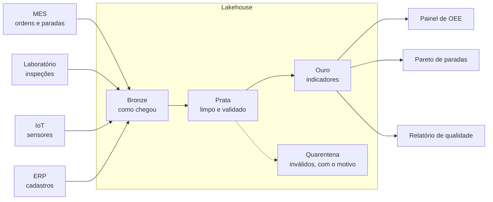

# 🏭 Case Mensal #01 · OEE de uma fábrica de alimentos

Um projeto completo de engenharia de dados para você fazer no seu ritmo e colocar no portfólio.

Você recebe 7 bases de 4 sistemas de uma fábrica, com dado sujo de propósito, e precisa entregar o indicador que a diretoria cobra: o **OEE** de cada linha de produção.

> Sem prazo e sem avaliação. O case é para a sua evolução.
> A empresa (Vale Norte Alimentos) e todos os dados são fictícios, gerados por simulação.

## Por que este case vale mais do que uma base do Kaggle

| Base pronta do Kaggle | Este case |
|---|---|
| Um arquivo limpo | 53 arquivos de 4 sistemas |
| Um formato só | CSV e JSON Lines, com dois fusos horários |
| Sem regra de negócio | Um indicador de verdade para calcular, com regras |
| Sem dado ruim | Duplicata, arquivo reenviado, registro inválido |
| Ninguém confere o resultado | Resultados esperados para você se corrigir |

É o tipo de problema que aparece no trabalho, e é isso que um recrutador quer ver.

## O que tem neste repositório

| Arquivo | O que é |
|---|---|
| [01 - OEE de uma fábrica de alimentos.pdf](01%20-%20OEE%20de%20uma%20f%C3%A1brica%20de%20alimentos.pdf) | O guia do case (20 páginas): cenário, bases, arquitetura, requisitos, regras e resultados esperados |
| [01 - Base de dados.zip](01%20-%20Base%20de%20dados.zip) | As 7 bases, um LEIA-ME e um modelo de README para o seu repositório |

**Leia o PDF inteiro antes de começar.** Todos os requisitos e as regras de cálculo estão lá.

## O cenário

A fábrica tem quatro linhas de embalagem (biscoito recheado, biscoito salgado, massas e achocolatado em pó), que rodam de segunda a sábado, das 06:00 às 22:00. Cada área tem a sua planilha e os números não batem. A diretoria quer uma fonte única que responda:

1. Qual é o OEE de cada linha?
2. Quais motivos de parada custam mais tempo?
3. Qual produto mais reprova, e quanto damos de sobrepeso?
4. Quanto tempo de máquina parada ninguém apontou?

**OEE = Disponibilidade × Performance × Qualidade.** A linha rodou? Rodou na velocidade certa? Saiu produto bom?

## As bases

| Base | Sistema | Formato | Arquivos | Linhas |
|---|---|---|---|---|
| `ordens_producao` | MES | CSV | 14 | 159 |
| `paradas` | MES | CSV | 12 | 269 |
| `inspecoes` | Laboratório | CSV | 12 | 1.305 |
| `sensores` | IoT | JSON Lines | 12 | 45.961 |
| `produtos` | ERP | CSV | 1 | 11 |
| `linhas` | ERP | CSV | 1 | 4 |
| `motivos_parada` | ERP | CSV | 1 | 9 |

Período de 02 a 14/11/2026, um arquivo por dia. O dicionário de dados completo está no PDF.

## A arquitetura que você vai construir

## Três níveis

| Nível | O que você entrega |
|---|---|
| **Essencial** | Bronze, Prata e Ouro com ordens, paradas e cadastros. OEE por linha e dia, e paradas por motivo |
| **Intermediário** | Inspeções de qualidade, rodar duas vezes sem duplicar, marcar dias com dado incompleto, testes na Prata |
| **Avançado** | Sensores com ajuste de fuso, microparadas, carga incremental e orquestração |

A ferramenta é livre. Pare no nível que fizer sentido para você.

## Como começar

1. Baixe o PDF e o zip.
2. Leia o PDF até o fim.
3. Descompacte a base e abra um arquivo de cada pasta antes de escrever código.
4. Faça o nível essencial e confira os seus números com os do PDF.
5. Suba para o seu GitHub usando o `README_modelo.md` que vem dentro do zip.

## 💡 5 ideias para transformar o case em portfólio

A mesma base rende projetos bem diferentes. Escolha a que combina com a vaga que você quer.

### 1. Lakehouse local com Python, DuckDB e Parquet

O caminho mais direto para o nível essencial. Bronze, Prata e Ouro em pastas de Parquet, transformações em SQL com DuckDB e um script que roda tudo em ordem.

**O que mostra:** fundamento de camadas, SQL e organização de projeto, sem depender de nuvem.

### 2. Projeto dbt com testes e documentação

Modelos de staging, Prata e Ouro no dbt (com DuckDB ou Postgres). As regras de validação do PDF viram testes, e a quarentena vira um modelo próprio. Publique a documentação gerada com o gráfico de linhagem.

**O que mostra:** engenharia de analytics, teste de dado e documentação, que é o que times de dados modernos pedem.

### 3. Medalhão no Databricks com Delta e carga incremental

Suba os arquivos no Databricks Free Edition, leia com Auto Loader, grave em Delta e trate o arquivo reenviado com `MERGE`. Agende com um Job.

**O que mostra:** Spark, Delta Lake e ingestão incremental em uma plataforma que o mercado usa.

### 4. Pipeline orquestrado com Airflow e Docker

Uma DAG diária que processa só o arquivo do dia, com `docker compose up` para subir tudo. Registre em uma tabela quantas linhas entraram, quantas foram para a quarentena e quanto tempo levou.

**O que mostra:** orquestração, idempotência e observabilidade, que é a diferença entre um script e um pipeline.

### 5. Painel de OEE e análise dos sensores

Um painel no Power BI ou Streamlit em cima da Ouro: OEE por linha, pareto de paradas e sobrepeso por produto. Feche com a análise dos sensores (microparadas e o comportamento da vibração antes das quebras) e uma recomendação para a fábrica.

**O que mostra:** que você entende o negócio e transforma dado em decisão, não só em tabela.

**Em qualquer uma delas, o que faz o projeto se destacar:**

- O diagrama da sua arquitetura no README.
- Os seus números ao lado dos esperados.
- Cinco decisões que você tomou e por quê.
- O que você faria diferente em produção.

## Travou?

Leve a dúvida para a comunidade. Resolveu? Ajude quem está travado e compartilhe o seu repositório no grupo.

## Sobre

Case criado por **Walter Gonzaga** para o **Comunidados**, comunidade de profissionais de dados.

Quer mais projetos como este, com revisão e mentoria? Conheça o [QG da Engenharia de Dados](https://qg-engenharia-de-dados.com.br).
